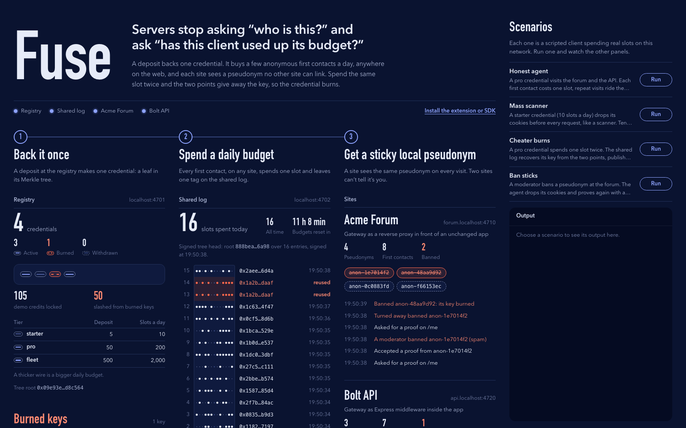

# Fuse

**Fair play online, no names needed.**

Fuse lets websites stop mass abuse of their logins, APIs and upload forms
without knowing who anyone is. Every visitor gets a daily budget of first
contacts, and zero-knowledge proofs enforce it.


▶ **[Watch the 3-minute animated explainer](https://www.youtube.com/watch?v=QrJPH10kAC4)**

> **Early prototype.** The cryptography is real; the money is play money.
> Nothing has been audited, so don't put it in front of anything that matters yet.

This repository holds the whole system: a Chrome extension for people, an SDK
and command-line tool for AI agents, and the server side, which is a registry,
a shared log and a gateway you put in front of a website.

## The problem

A server facing a stranger asks: *who is this, and can I trust them?* To
answer, it checks faces: IP addresses, accounts, CAPTCHAs. Attackers rotate the
mask. A new IP or a new account is a new visitor, and they try millions of
times a day.


## The idea

Fuse changes the question to *has this client used up its budget?* Mass abuse
is a quantity problem: one actor, millions of tries. A quantity can be enforced
with math, without anyone learning who anyone is.

### 1. Back it once

You put down a deposit at a registry once and get a credential. The registry
records the deposit but never learns where the credential is used. In this
prototype the deposit is play money; passports and EU digital-identity
wallets are planned alternatives.

### 2. Spend a daily budget

Each credential gets a fixed number of first-contact tickets a day, for example
200, valid anywhere on the web. The first time you touch a site's login, API
or upload form costs one ticket. Reading public pages is free, and after the
first contact the site's normal session takes over.

You spend a ticket by sending a zero-knowledge proof that says "a valid
credential, within its budget" without saying whose. Your own device makes the
proof, in about 0.2 seconds on an Apple-silicon Mac.


### 3. Get a sticky pseudonym on each site

Each site sees its own pseudonym for you. The same site always sees the same
one, so a ban sticks. Two different sites can't tell they're seeing the same
person.


### 4. Cheating confesses

Every ticket you spend is one point on a secret line, and the line crosses
zero at your key. One point reveals nothing. Spend the same ticket twice and
the two points fix the line, which gives away the key. The shared log
publishes it, your deposit is forfeit, and every site turns you away.


### What it does to attackers


A million attempts a day at 200 tickets per credential needs 5,000 deposits.
An honest person needs one. Fuse can't judge intent: one carefully aimed attack
that stays within budget still gets through. What it removes is cheap,
unlimited volume.

## Try it in five minutes

You need Node.js 22 or newer (developed on Node 26), and Chrome for the extension.

```bash
git clone https://github.com/veiovi/fuse.git
cd fuse
npm install
npm run demo
```

This starts a registry, a shared log, two demo websites and a live view of the
whole network on your machine:

| Open | What it is |
|---|---|
| http://localhost:4700 | **Explorer**: the registry, the shared log, burned keys and both sites, live, plus four one-click scenarios |
| http://forum.localhost:4710 | **Acme Forum**, an ordinary web app behind the Fuse gateway |
| http://api.localhost:4720 | **Bolt API**, an Express API with the Fuse gateway built in |

In the explorer, run the four scenarios: an honest agent, a mass scanner that
runs out of budget, a cheater whose key is recovered, and a ban that sticks to
an anonymous pseudonym.



If your system doesn't resolve `*.localhost` names, add
`127.0.0.1 forum.localhost api.localhost` to `/etc/hosts`.

### As a person: the Chrome extension

1. Run `npm run build:extension`.
2. Open `chrome://extensions`, turn on **Developer mode**, click
   **Load unpacked** and choose `packages/extension/dist`.
3. In the Fuse popup, choose **Get a credential** (the starter tier gives
   10 tickets a day).
4. Open http://forum.localhost:4710/new. The extension asks before it spends a
   ticket, makes the proof in the browser, and you're in as `anon-…`.

### As an AI agent: the SDK and CLI

```bash
npx fuse init --tier pro    # one credential, 200 tickets a day
npx fuse fetch "http://api.localhost:4720/v1/search?q=hello"
npx fuse status
```

From code inside this repository (the packages aren't on npm yet):

```js
import { FuseAgent } from '@fuse/agent';

const agent = await FuseAgent.create({ registry: 'http://localhost:4701', tier: 'pro' });

// fetch() answers the site's Fuse challenge by itself.
const res = await agent.fetch('http://api.localhost:4720/v1/search?q=hello');
```

### On your own site: the gateway

As Express middleware:

```js
import { fuseGateway } from '@fuse/gateway';

app.use(fuseGateway({
  siteName: 'My app',
  origins: ['https://myapp.example'],
  protect: ['/login', '/api/*'],
  registries: ['http://localhost:4701'],
  log: 'http://localhost:4702',
}));
// Protected handlers see req.fuse = { pseudonym, short, reputation }.
```

Or as a reverse proxy in front of any app:

```bash
npx fuse-gateway --upstream http://127.0.0.1:3000 --protect "/login,/api/*" \
  --registry http://localhost:4701 --log http://localhost:4702
```

## How a first contact works

1. The client asks for a protected page. The gateway answers `401` with a
   one-time challenge: `WWW-Authenticate: Fuse challenge="…"`.
2. The client reserves a ticket and proves, in zero knowledge: "I hold a
   credential in this registry, this ticket is within my daily budget, here
   is one point on my line, here is the ticket's tag, and here is my pseudonym
   for this site."
3. It retries with `Authorization: Fuse origin="…", challenge="…", token="…"`.
   The token is 389 bytes.
4. The gateway verifies the proof and adds the ticket's tag to the shared log.
   A new tag opens a session. A tag the log has already seen at another point
   reveals the key and burns the credential.
5. Everything after that rides the site's normal session.

Nothing changes in IP, DNS, TLS or browsers, and a site can turn Fuse on one
endpoint at a time.

## What's in the repository

| Path | What it is |
|---|---|
| [`circuits/fuse.circom`](circuits/fuse.circom) | The zero-knowledge circuit: Rate-Limiting Nullifier (RLN) plus a per-site pseudonym (Groth16, 6,076 constraints) |
| [`packages/core`](packages/core) | Shared cryptography and wire format: Poseidon hash, Merkle tree, key recovery, token, proving and verifying |
| [`packages/registry`](packages/registry) | Deposit-backed registry: issues credentials, publishes valid tree roots, burns deposits |
| [`packages/log`](packages/log) | Shared append-only log of ticket tags: catches a reused ticket, recovers the key, publishes it |
| [`packages/gateway`](packages/gateway) | The gateway, as Express middleware or a reverse proxy: proofs, sessions, sticky bans, a strict request check |
| [`packages/agent`](packages/agent) | Agent SDK and the `fuse` command-line tool |
| [`packages/extension`](packages/extension) | Chrome extension (Manifest V3): asks before spending, proves in the browser |
| [`packages/explorer`](packages/explorer) | The live network view and scenario runner |
| [`demo/`](demo) | Two demo sites, four scenarios and the one-command runner |

## What's real and what isn't

**Real:**

- Groth16 zero-knowledge proofs, made on the device and checked by every gateway and the log
- private membership in the registry, and per-site pseudonyms
- daily budgets, key recovery from a reused ticket, burning the credential and its deposit
- an append-only log with signed tree heads and inclusion proofs
- sticky bans and per-pseudonym rate limits

**Simulated or simplified:**

- deposits are play money
- the proving keys come from a single-party development setup, so whoever ran it could forge proofs
- there is one registry and one log
- the gateway's request check is hand-written and fuzz-tested, not formally verified

**Designed but not built:** passport and EU-wallet credentials, and a formally
verified request parser at the gateway.

[docs/design.md](docs/design.md) lists every simplification and open problem.

## Documentation

- [docs/design.md](docs/design.md): the design, who learns what, the security
  properties and their limits.
- [docs/protocol.md](docs/protocol.md): the exact messages between the components.
- [docs/demo.md](docs/demo.md): a walkthrough of the demo.

## Development

```bash
npm test                               # unit and integration tests, with real proofs
node packages/extension/test/e2e.mjs   # the extension in a real Chromium (via playwright-core)
npm run build:circuit                  # recompile the circuit and redo the setup (needs circom 2.1+)
```

## Prior work

Fuse combines existing pieces:

- **Rate-Limiting Nullifiers** from the Privacy & Scaling Explorations team, as
  used for spam protection in Waku. These descend from 1980s digital cash that
  exposed anyone who spent a coin twice.
- **Privacy Pass** (RFC 9576–9578), whose HTTP authentication shape Fuse's
  headers follow.
- **Certificate Transparency** (RFC 6962), the model for the shared log.
