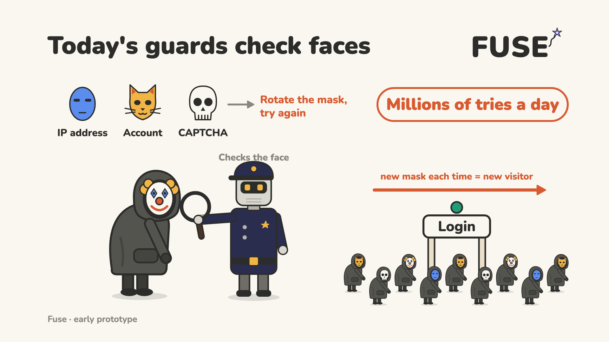
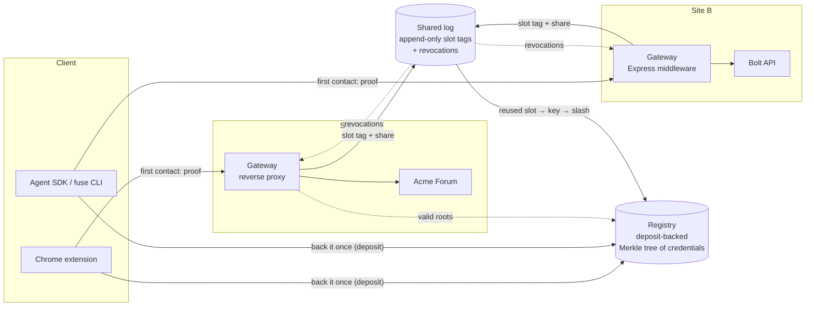
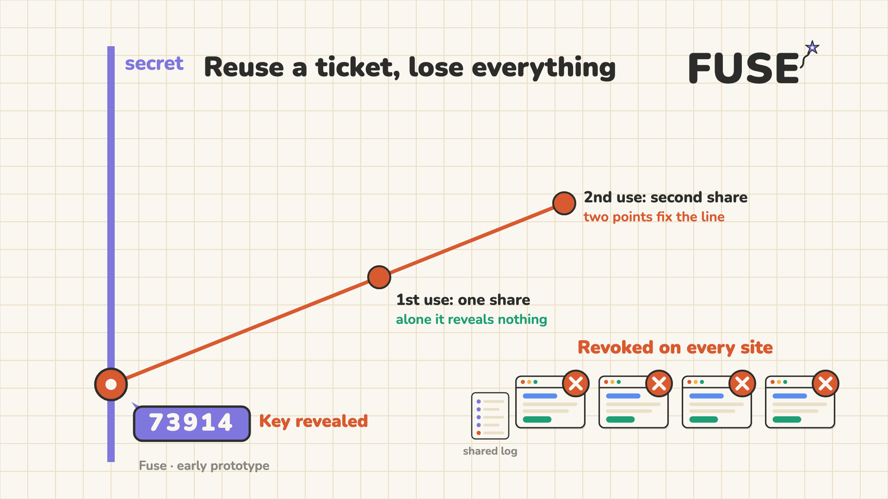
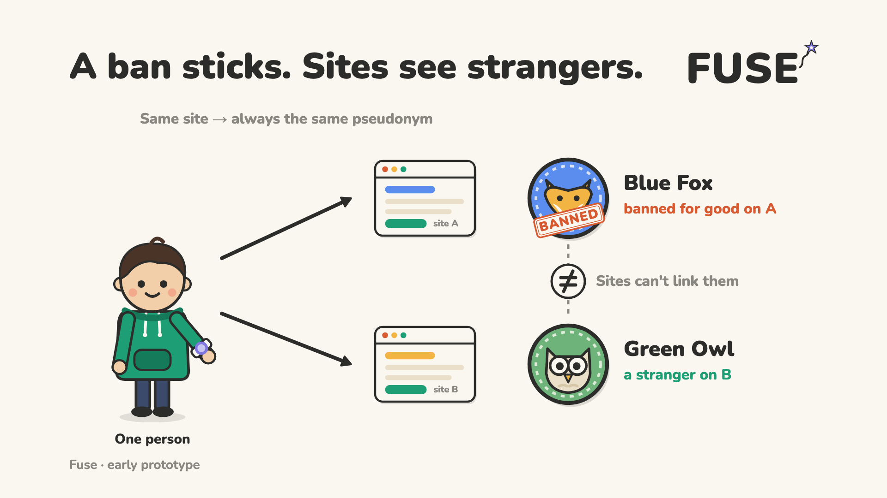
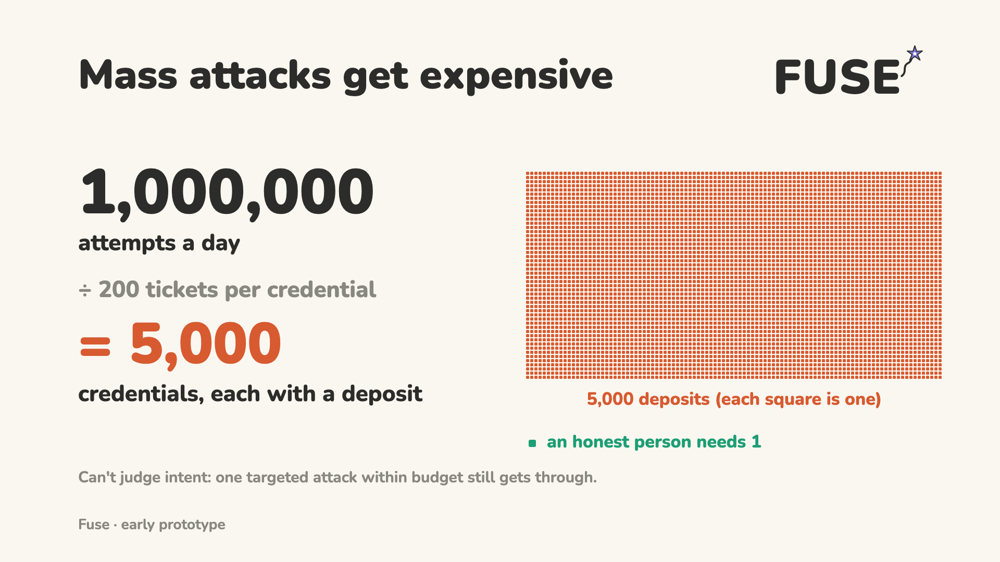

# Fuse design

Fuse is a working prototype of anonymous, rate-limited access to the protected
parts of websites (login, posting, uploads, APIs, admin pages). It runs on top
of ordinary HTTP. Nothing changes in IP, DNS, TLS or browsers, and a site can
switch it on one endpoint at a time.

## 1. The idea

Today a server facing a stranger asks **"who is this, and do I trust them?"**
That question is what drags in identity checks, IP reputation databases,
CAPTCHAs and gatekeepers.

Fuse lets the server ask a different question: **"has this client used up its
budget?"** Mass exploitation is a quantity problem: one actor, millions of
probes. Quantities can be enforced cryptographically without anyone learning
who anyone is.

The name describes the behaviour: a fuse carries normal current forever and
blows the moment something overdraws it, without taking anything else down.



A three-minute animated version of this document is on YouTube:
[Fuse: fair play online, no names needed](https://www.youtube.com/watch?v=QrJPH10kAC4).

## 2. Components



| Component | Role | Code |
|---|---|---|
| Circuit | Groth16 circuit: RLN plus a per-site pseudonym (6,076 constraints) | [`circuits/fuse.circom`](../circuits/fuse.circom) |
| Core library | Poseidon, Merkle tree, shares, token format, prove/verify | [`packages/core`](../packages/core) |
| Registry | Takes a (simulated) deposit, adds the credential to its tree, publishes valid roots, slashes burned keys | [`packages/registry`](../packages/registry) |
| Shared log | Append-only log of slot tags; detects a reused slot, recovers the key, publishes the revocation | [`packages/log`](../packages/log) |
| Gateway | Requires a Fuse proof on protected routes, issues sessions, keeps per-pseudonym reputation, caches public pages | [`packages/gateway`](../packages/gateway) |
| Agent SDK | Holds a credential for an AI agent or script; answers challenges automatically | [`packages/agent`](../packages/agent) |
| Extension | Holds a credential for a person; asks before spending; proves in the browser | [`packages/extension`](../packages/extension) |
| Explorer | Live view of the network and a scenario runner for the demo | [`packages/explorer`](../packages/explorer) |
| Demo | Two protected sites, four scenarios, one-command runner | [`demo/`](../demo) |

The exact messages between them are in [protocol.md](protocol.md).

## 3. The core trick: cheating that confesses

Two points determine a line.

A credential hides a secret number `k`, the key. For each slot it spends, the
client derives a secret slope `a`. Spending a slot means handing the server one
point on the line

```
y = k + a·x
```

where `x` is fixed by the server and the request.

- **One point reveals nothing.** Infinitely many lines pass through it.
- **Two points from the same slot reveal everything.** Anyone holding both can
  draw the line, and its value at `x = 0` is the key.

```
  y
  │            ● (x₂, y₂)      second use of the same slot
  │          ╱
  │        ╱
  │      ● (x₁, y₁)            first use
  │    ╱
  │  ╱
  ●╱  ← k: the line meets the y-axis at the key
  │
  └──────────────────── x
```

A zero-knowledge proof attached to each point convinces the server that the
point comes from a valid, unrevoked credential, without revealing whose. Honest
use is anonymous; overuse publishes the key. No judge and no identity registry
are needed.

This is the Rate-Limiting Nullifier (RLN) construction used for spam
protection in Waku's peer-to-peer messaging, which in turn descends from 1980s
offline digital cash that exposed anyone who spent a coin twice.



### Concretely

Everything lives in the BN254 scalar field and uses the Poseidon hash.

| Value | Definition |
|---|---|
| slope | `a = Poseidon(k, externalNullifier, slot)` |
| external nullifier | `Poseidon(epoch, networkId)`: the same for every site, so the budget is global |
| x | `H("fuse/x", origin, challenge)`: fresh for every first contact |
| share | `y = k + a·x` |
| slot tag | `nullifier = Poseidon(a)`: what the shared log indexes |
| pseudonym | `Poseidon(k, siteId)` with `siteId = H("fuse/site", origin)` |

The circuit ([`circuits/fuse.circom`](../circuits/fuse.circom)) proves, with
`k`, the limit, the slot and the Merkle path kept private:

1. `Poseidon(Poseidon(k), limit)` is a leaf of the registry tree with the public root;
2. `slot < limit`;
3. `y`, the slot tag and the pseudonym are computed from that same `k`.

The verifier recomputes `x`, the external nullifier and `siteId` itself, so a
proof is bound to one site, one challenge and one day.

## 4. The three parts


### 4.1 Back it once

A client gets a credential by putting up something scarce. In the prototype the
registry takes a simulated deposit:

| Tier | Deposit (demo credits) | Slots per day |
|---|---|---|
| starter | 5 | 10 |
| pro | 50 | 200 |
| fleet | 500 | 2,000 |

The client generates `k` locally and sends only the commitment `Poseidon(k)`.
The registry stores the leaf `Poseidon(commitment, limit)` in a depth-20 Merkle
tree (about a million credentials) and publishes its roots. Binding the limit
into the leaf lets budgets scale with the backing (a bigger deposit buys more
slots, and loses more if it burns) without the proof revealing the tier.

The registry's job ends there: it never sees a proof and never learns where a
credential is used. Clients download the whole leaf list and compute their
Merkle path locally, so the registry cannot tell who is about to spend.

Other backings slot in as other registries with their own trees: a passport
(zero-knowledge passport proofs with a one-time tag per document), an EU
digital identity wallet, an attested device, or a zkTLS proof of a long-held
account. Each gateway decides which registries' roots it accepts.

### 4.2 Spend a daily budget

Each credential gets `limit` first-contact slots per epoch (one UTC day) across
the whole network. Public, cacheable pages cost nothing. The first time a
client touches a site's protected surface, it spends one slot.

The client keeps the bookkeeping: it reserves the lowest unused slot and saves
that **before** proving, because a slot counts as spent once a proof exists
(retrying it with a new challenge would put a second point on the same line).

Catching reuse needs one shared, append-only log of slot tags. Every gateway
forwards each accepted first contact to it. Honest tags look random, so the log
learns nothing about honest users and everything about cheaters:

- a new tag is appended, and the gateway gets a signed receipt;
- the same tag with the same share is a replay and is refused;
- the same tag with a different share is a double-spend: the log recovers `k`,
  sends it to the registry, which removes the leaf and slashes the deposit, and
  publishes a revocation containing the key and both shares.

The log is a transparency log in the style of Certificate Transparency
(RFC 6962): entries are leaves of a Merkle tree, the log signs tree heads, and
anyone can check that an entry is included.

Burning has three effects:

1. The leaf is removed and the registry's list of valid roots is reset, so
   every future proof from that key fails.
2. The deposit is forfeit.
3. Because the key is public, every gateway computes the cheater's pseudonym
   at its own site, bans it and ends its open sessions.

### 4.3 Get a sticky local pseudonym

A client's pseudonym at a site is `Poseidon(k, siteId)`.

- **Same site:** the same pseudonym every time, so a ban sticks. The site
  never learns who it banned.
- **Different sites:** unrelated pseudonyms, so nobody can follow a client
  across the web.

Each gateway runs its own reputation on pseudonyms: probation for new ones,
more room over time, permanent bans. Only the first contact needs a proof;
after that the site's ordinary session cookie takes over, so proving is rare.
Evading a ban costs a new deposit (or passport), not a new IP address.

The site id is derived from the origin **the client actually connected to**,
never from anything the server says. Otherwise a malicious site could ask a
client to prove for `bank.example` and learn its bank pseudonym.



### 4.4 What it does to attack economics

IP addresses stop mattering on protected surfaces, so rotating proxies buys
nothing there. At 200 slots per credential per day, a million first contacts a
day needs 5,000 credentials, each backed by its own deposit; an honest person
needs one. Every pseudonym that misbehaves is banned for good at that site,
and every overdraw burns its credential. Renting credentials out stops paying,
because the owner inherits the renter's bans.



## 5. A first contact, step by step

```mermaid
sequenceDiagram
  autonumber
  participant C as Client (extension or SDK)
  participant G as Gateway (site)
  participant R as Registry
  participant L as Shared log
  C->>G: GET /me (no session)
  G-->>C: 401 WWW-Authenticate: Fuse challenge="…"
  C->>R: GET /tree (all leaves; path computed locally)
  Note over C: reserve slot s, save wallet<br/>prove: member, s < limit,<br/>y = k + a·x, tag, pseudonym
  C->>G: GET /me + Authorization: Fuse origin, challenge, token
  G->>G: check challenge MAC, expiry, single use, origin
  G->>G: verify Groth16 proof against own origin + challenge
  G->>R: GET /roots (cached)
  G->>L: POST /entries {token, x, siteId}
  L-->>G: 201 fresh + signed receipt
  G-->>C: 200 /me + Set-Cookie session + Fuse-Pseudonym: anon-…
  C->>G: later requests ride the session (no proof)
```

The token is 389 bytes (519 base64url characters): a 256-byte Groth16 proof,
the epoch, and the four public outputs. On an Apple-silicon Mac, proving takes
about 0.2 s both in Node and inside the Chrome extension (160–240 ms measured
in Chromium 151); verifying takes a few milliseconds.

## 6. Who learns what

| Party | Learns | Does not learn |
|---|---|---|
| Site (gateway) | Its own pseudonym for the client; that it is a member of an accepted registry; that a slot was spent | The key, the registry member, the slot number, the client's pseudonyms elsewhere, how much budget is left |
| Registry | Who deposited and their commitment (it took the deposit) | Where or when the credential is used |
| Shared log | A random-looking tag, one share and the epoch per first contact; during verification also the site id and pseudonym, which it discards | Which member spent; anything linking tags to each other or to people |
| Other sites | Nothing | |
| Network observer | That a Fuse header was sent | Its contents (TLS) |

After a double-spend, everyone learns the cheater's key, so their pseudonyms
at every site become linkable. That is the deliberate penalty.

## 7. Security properties

- **Anonymity**: a proof shows membership in a registry's tree, not which
  leaf. The anonymity set is every active credential in that registry.
- **Unlinkability**: pseudonyms and slot tags are Poseidon outputs keyed by
  `k`; without `k` they look independent across sites and slots.
- **Budget soundness**: the slot tag is a deterministic function of
  `(k, epoch, slot)` and the circuit forces `slot < limit`, so a credential has
  at most `limit` distinct tags per epoch. Any further first contact repeats a
  tag with a new `x`, which the log turns into the key.
- **No framing**: recovering `k` needs two valid proofs from `k`. A forged
  second share yields a value whose commitment matches no member, so the
  registry refuses to slash.
- **Origin binding and freshness**: the proof commits to `x = H(origin,
  challenge)` and to `siteId`, so a token works at one site, for one challenge
  (single-use, 120-second TTL, HMAC-authenticated by the gateway).
- **Self-authenticating slashing**: knowing `k` is the evidence. The registry
  checks `Poseidon(k)` against its members and needs no trusted reporter.

## 8. Where the math stops

Math enforces how much, how many and how unique. It cannot judge intent: one
carefully aimed exploit from a legitimate credential, inside its budget, still
lands. Raw bandwidth floods remain a network-level problem.

The second half of the design shrinks what a stranger can send at all: put a
parser in front of the app that accepts only requests matching the app's
formal spec, with a machine-checked proof that malformed input cannot crash or
confuse it (the approach behind EverParse-generated parsers). The gateway has
that slot: its **spec gate** checks method, path, query, content type, body
size and fields against a declared route list before any proof work. In this
prototype the gate is a small hand-written total function with randomized
tests, **not** a verified parser.

The release-integrity half of the original design notes (threshold-signed
releases, reproducible builds) is out of scope here.

## 9. What is real and what is simulated

Real:

- Groth16 zero-knowledge proofs over the circuit in this repo, generated in
  Node and in the browser and verified by gateways and the log.
- Poseidon Merkle membership, slot range checks, per-site pseudonyms.
- Key recovery from a reused slot, slashing, revocation and session teardown.
- An append-only log with RFC 6962 inclusion proofs and Ed25519-signed tree heads.
- Sticky bans on pseudonyms and per-pseudonym rate limits.

Simulated or simplified:

- **Deposits** are "demo credits"; no money moves.
- **Trusted setup** is a single-party development ceremony
  ([`scripts/build-circuit.sh`](../scripts/build-circuit.sh)). Whoever ran it
  could forge proofs. Production needs a multi-party ceremony or a transparent
  proof system.
- **One registry, one log**, each a single process with JSON files.
- **Tree download**: clients fetch every leaf to compute their path privately.
  Fine for thousands of members; millions need a better private retrieval scheme.
- **Site ids are origins** (`scheme://host:port`), not registrable domains.
  Each gateway lists the origins it answers for, and each listed origin is a
  separate site id, so a site should list one. The demo's two sites use
  separate host names (`forum.localhost`, `api.localhost`) because browsers
  share cookies across ports on the same host; served under a single host name
  (as on a Tailscale address), one demo site could read the other's session
  cookie.
- **Withdrawal** reveals `k` to the registry at exit; a real exit would prove
  knowledge of `k` in zero knowledge.
- **Admin endpoints** on the demo gateways have no authentication.

## 10. Known problems

- **Exclusion.** Many people have no passport or spare money for a deposit, so
  several backings must be first-class, and anonymous read-only access stays free.
- **Infected devices** can spend their owner's budget. The cap limits the
  damage and the extension's spend log makes it visible, but recovery needs work.
- **Multiple devices** sharing one credential will collide on slots and burn
  it. Give each device its own credential, or partition slots between devices.
- **Root resets.** Removing a member (burn or withdrawal) restarts the
  registry's list of valid roots, because older roots still contain the
  removed leaf. A proof generated just before that moment fails and costs its
  client one slot.
- **Day boundaries.** Verifiers accept the neighbouring epoch for five minutes
  around midnight UTC to absorb clock skew, which allows a short burst of up to
  two days' budget.
- **Interstitials on POST.** If a browser's first contact is a form POST, the
  extension reloads the page after redeeming, and the browser asks whether to
  resubmit the form. The demo keeps protected entry points on GET pages.
- **The log sees site ids** while it verifies proofs. A production log could
  accept gateway-attested submissions instead, or verify a proof that hides the site.
- **Log scale.** A web-scale log absorbs billions of entries a day. Random tags
  shard easily, but someone has to run it.
- **The penalty is harsh.** Publishing `k` links every pseudonym of a cheater.
  That is the deterrent, but a buggy client could trigger it; clients must
  never reuse a slot, even after a failed request.
- **Passport backings** prove access to a chip's data, not that the holder is
  present; a one-time tag per document limits each document to one credential.
- **Standards are unsettled.** There is no standard for a cross-site budget.

## 11. Parameters

| Parameter | Value |
|---|---|
| Network name | `fuse-demo-v1` |
| Epoch | 86,400 s (UTC day), ±300 s grace at the boundary |
| Tree depth | 20 (≈1M credentials per registry) |
| Limit range | < 2^16 slots per epoch |
| Proof system | Groth16 on BN254 (snarkjs), circom 2.2.2, 6,076 constraints |
| Token | 389 bytes |
| Challenge | HMAC-SHA256, single use, 120 s TTL |
| Session | HttpOnly cookie, 24 h |
| Reputation | probation for 24 h (60 req/min), then member (600 req/min) |

## 12. References

- Rate-Limiting Nullifier (PSE): rate-limiting.github.io/rln-docs, and the
  `circom-rln` circuits this circuit follows.
- Waku RLN relay: the deployed spam-protection use of RLN.
- D. Chaum, A. Fiat, M. Naor, "Untraceable Electronic Cash", CRYPTO 1988.
- Privacy Pass: RFC 9576 (architecture), RFC 9577 (HTTP authentication
  scheme, which Fuse's headers mirror), RFC 9578 (issuance).
- Certificate Transparency: RFC 6962 (Merkle tree hashing, audit paths).
- Poseidon hash: Grassi et al., USENIX Security 2021.
- Groth16: J. Groth, "On the Size of Pairing-based Non-interactive Arguments", EUROCRYPT 2016.
